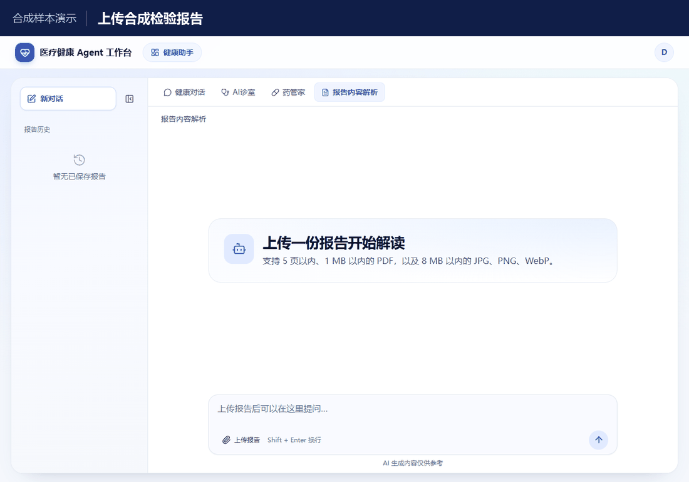
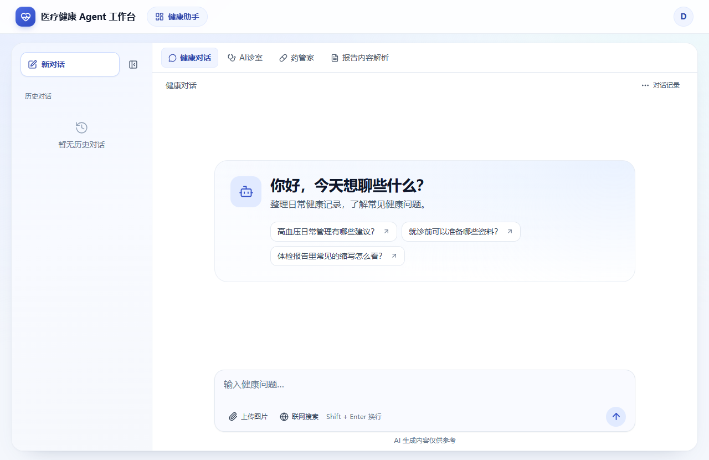
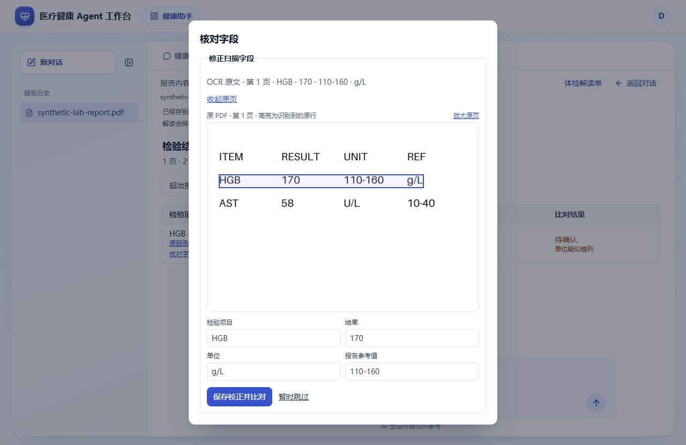
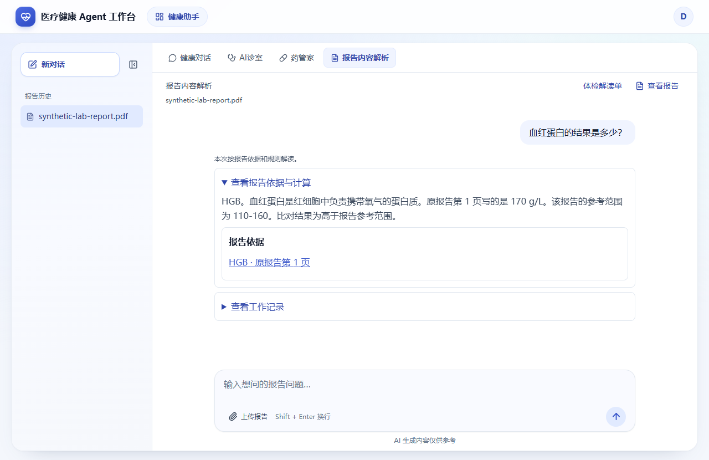
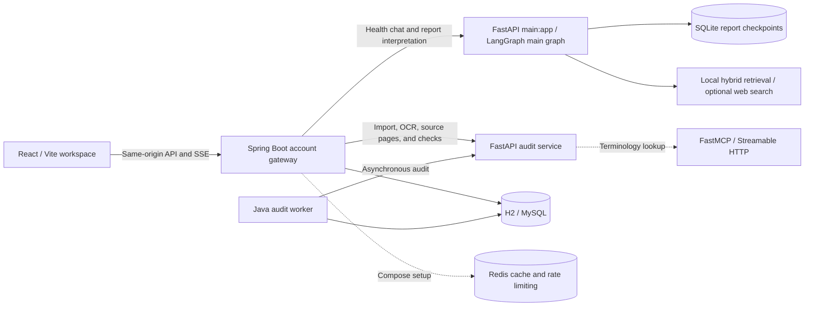

# Medical Health Agent Workbench

[简体中文](README.md) · [Demo](#demo) · [Features](#features) · [Architecture](#architecture) · [Quickstart](#quickstart) · [Evaluation and tests](#evaluation-and-tests)

One account gives you a workspace for health questions, text-based intake, medication information, and lab report interpretation. Extracted results link to their page and row in the original document. You can review and correct fields, read a patient-friendly summary, and ask follow-up questions about the same report. An asynchronous audit demo uses synthetic medical records to show how source-record checks, report revisions, and corrections affect earlier answers.

## Demo



1. Follow the [quickstart](#quickstart), sign in, and upload the [synthetic lab report PDF](docs/demo/synthetic-lab-report.pdf) in [Report interpretation (requires local startup)](http://127.0.0.1:5173/#/report-audit).
2. Open the hemoglobin (HGB) row flagged for review in the report view. Check the original page and correct the unit and reference range, which appear in the wrong columns.
3. Read the updated patient summary or ask what hemoglobin value the report shows, then open the source-page citation from the answer.
4. Load the built-in example in the [simulated audit (requires local startup)](http://127.0.0.1:5173/#/report-audit-demo) and ask for the original hemoglobin and white blood cell records. Submit a correction using the source hemoglobin record. The new version rechecks one item and reuses two. Open the correction impact view to review the affected answer.

<details>
<summary>View screenshots</summary>

| Workspace and report summary | Source review and cited follow-up |
| --- | --- |
|  |  |
|  |  |

</details>

## Features

| Entry point | What you can do |
| --- | --- |
| Health chat | Ask about health topics, lifestyle, risk, and visit preparation. View local retrieval and web source cards. The web search toggle is also available in medication conversations outside clinic intake. |
| AI clinic | Start text-based intake. The assistant checks for red flags, extracts symptom details, and asks follow-up questions. It gives urgent alerts, suggested care timelines, department guidance, and a triage card. |
| Medication assistant | Ask about a drug by name or use a photo of its packaging or traceability code. Tools cover drug information, contraindications, interactions, over-the-counter options, dose calculations, and a simulated pharmacy list. Traceability codes are handled through image recognition. |
| Report interpretation | Upload a PDF or a JPG, PNG, or WebP photo. Explore the full report or a single result, filter for out-of-range items or items needing confirmation, highlight and correct source fields, and open the patient summary. Ask about individual results, related measurements, or the full report. |

The workspace supports registration, sign-in, and sign-out. Create, switch, and clear conversations within health chat, AI clinic, and medication. Reopen saved reports from report history. The desktop sidebar and mobile history panel share a conversation layout, and the large-text setting increases text size.

The report module also includes two demo workflows.

- **Simulated lab audit** accepts pasted text, template PDFs, Excel workbooks (`.xlsx` / `.xls`), and UTF-8 text. Save drafts, submit individual reports or batches of up to 25, track and retry jobs, and browse versions. Ask about source records from current or past encounters, recheck changed items, and confirm reviews of affected answers. [Open the simulated audit (requires local startup)](http://127.0.0.1:5173/#/report-audit-demo)
- **Photo chat** offers vision-model extraction, a press-to-reveal blurred preview, pasted lab details, in-session follow-up, and history clearing. Standalone mode uses `#/report-photo`. [Open the photo interpretation demo (requires local startup)](http://127.0.0.1:5173/#/report-photo-demo)

## Architecture



| Layer | Technology and responsibilities |
| --- | --- |
| [Frontend](frontend/) | React 19, TypeScript, Vite 7, Tailwind CSS, PostCSS, and Lucide. React Context manages UI state, React Markdown and remark-gfm render answers, and typed SSE events drive text, progress, and result cards. Development checks use ESLint, TypeScript, and Playwright. |
| [Application](application/) | Java 21, Spring Boot 3.5, Spring MVC, JDBC / HikariCP, Flyway, Actuator, and Resilience4j. H2 or MySQL stores accounts, conversations, structured reports, revisions, jobs, and audit answers. Redis provides revision-keyed result caching and Lua-based rate limiting. |
| [Agent service](backend/agents/) | Python 3.13, uv, FastAPI / Uvicorn, Pydantic, LangGraph, LangChain, httpx, and the OpenAI SDK and compatible APIs for routing, context, tools, checkpoints, and server-sent events (SSE). |
| [Report processing](backend/report_audit/) | PDFium (`pypdfium2`), pypdf, RapidOCR / ONNX Runtime, Pillow, openpyxl, and xlrd. SQLite stores standalone audit snapshots. |
| [FastMCP terminology service (separate process)](backend/report_audit/mcp_server.py) | The Compose `knowledge` service exposes lab terminology over Streamable HTTP. |
| [Operations and validation](docs/observability-evals.md) | Docker / Compose, OpenTelemetry / OpenInference, OTLP/HTTP, Jaeger, optional LangSmith, Python unittest, JUnit / Spring Boot Test, local evaluation, and optional DeepEval. |

### Agent routing, tools, and retrieval

- **Shared main graph.** `StateGraph` dispatches by structured report context, explicit mode, active specialist, and intent. The model generation paths for health advice, medication, and photo or text report chat use ReAct tool loops. Text intake uses a subgraph that starts with a rule-based safety check, then makes one structured call to extract symptoms and draft a follow-up. It uses `interrupt()` to wait for a reply when information is missing and uses ReAct when it reaches the triage conclusion node. Structured report interpretation has its own evidence and explanation nodes. Routes that support handoffs can transfer once per turn using `Command`. [LangGraph runtime](docs/langgraph-runtime.md)
- **Skill registry.** YAML metadata in `SKILL.md` drives discovery and role-based loading. Pydantic inputs and outputs are wrapped as LangChain tools, and `load_skill` dispatches skills by name. Built-in skills include `emergency_triage` (red flags), `symptom_scorer` (symptom severity), `health_calculator` (BMI and related measures), `risk_assessor` (Framingham / FINDRISC), `lab_interpreter` (reference range checks), and `medication_calculator` (dose calculations). [Skill system](docs/skills.md)
- **Local hybrid retrieval.** Health chat and intake retrieve before answering, medication tools retrieve on demand, and photo or text report chat can retrieve lab references. The knowledge base splits Markdown by headings and Chinese punctuation and retains source and section metadata. It combines BM25 and vector maximum marginal relevance (MMR) with reciprocal rank fusion (RRF) at weights of 0.3 and 0.7, with parallel multi-query retrieval, deduplication, and source filtering. Embedding options include Hugging Face / BGE, OpenAI, and Ark. Vector stores include Chroma, FAISS, Qdrant, pgvector, and an in-memory index. [Retrieval and indexing](docs/rag.md)
- **Opt-in web search.** When enabled in the chat composer, the service rewrites a redacted question into restricted medical keywords. It prefers PubMed records from Europe PMC and can fall back to MedlinePlus health topics. Separate cards show web and local retrieval status. [Web search implementation](backend/agents/web_search.py)
- **Model adapters.** Chat, structured report interpretation, and image recognition can use separate model settings. Text models support routing, structured extraction, and tool calls. Vision models handle drug packaging, traceability codes, and standalone photo chat. Source-page review uses local PDF and OCR processing. [Model configuration](backend/.env.example)

### From a report to a traceable answer

1. **Extract and review.** Upload PDFs up to 1 MB and five pages, or photos up to 8 MB and 24 megapixels. PDFium reads usable PDF text and coordinates first. RapidOCR handles scanned pages and photos locally, with targeted rereads for uncertain cells. The workbench flags high, low, in-range, or unconfirmed values using the report's own reference ranges and keeps the extracted value, page, and bounding region. Users can correct the test name, result, unit, or reference range. For a saved report, SHA-256 verifies a reselected source file before a page is rendered. An empty extraction can be retried.
2. **Verify evidence.** The main graph reuses confirmed fields from the selected report and checks for related values that are missing, unconfirmed, or ambiguous across samples. Lab references are filtered by aliases and ranked with BM25. Locally cached BGE weights can add vector retrieval and RRF to the initial model pass. Supported blood count checks cross-check plateletcrit and the relationship between total white blood cell count, differential percentages, and absolute counts. They track same-sample assumptions, units, and printed precision.
3. **Clarify and resume.** The report assistant can ask up to three questions, one at a time, based on the abnormalities and the user's request. Users can answer, skip, ask for a conclusion, or start a new question. `interrupt()` and `Command(resume=...)` resume the task against SQLite checkpoints tied to the report's field revision. Corrections rerun comparisons and answer the latest question against the updated revision.
4. **Agentic RAG and fallback.** The model can gather evidence through `lookup_report`, `search_lab_knowledge`, and `check_lab_relationships` in up to two tool rounds. The workflow checks citation allowlists and coverage of required groups of abnormal results and can ask for a targeted rewrite. Unconfirmed fields, urgent cases, or model failures can follow a rule-based or verified-evidence path. Validated passages can stream through SSE. Answers include source pages, references, missing information, and a work record. [Report workflow](REPORT_AUDIT.md) · [Interpretation implementation](backend/report_audit/reading.py)

### Asynchronous audit and correction impact

- **Deterministic checks.** The parser validates synthetic patient and encounter identifiers, test codes, and sampling dates. It accepts 10 lab codes and their registered aliases. LangGraph queries a replaceable `EvidenceSource`, then uses exact decimal comparisons and registered unit conversions to check dates, units, values, and missing evidence. Ambiguous source records are flagged for review. Answers cite the source record ID and revision. [Audit workflow](backend/report_audit/workflow.py)
- **Jobs and report versions.** The application writes the `Idempotency-Key`, report, and job in one transaction and checks the expected version on correction. MySQL workers claim jobs with `FOR UPDATE SKIP LOCKED`. A 45-second lease and claim token guard completion, with job recovery, backoff, and immutable version snapshots. The audit reuses a row result when its input, source record, and rules version match. Changes to the rules support a full recheck.
- **Evidence questions.** Rules route questions to current or historical records or to a knowledge node, carrying forward the last lab item mentioned. `REPORT_AUDIT_LLM_ROUTER=1` enables structured model classification when rules cannot determine intent. FastMCP exposes `lookup_lab_reference` over Streamable HTTP with optional hybrid retrieval and a local glossary fallback.
- **Correction impact.** The question-answering graph records dependencies on report fields. On publication, Java compares snapshots and creates review tasks for affected answers in the same transaction. Questions asked against older versions also check subsequently published corrections, including concurrent completions. Users can ask again and confirm the review. Unaffected answers remain accessible. [Transactions and jobs](APPLICATION.md)

### Sessions, streaming, and data

- Java uses PBKDF2 password hashing, HttpOnly and SameSite=Strict session cookies, and account ownership checks. It stores the question before forwarding SSE events such as `node_start`, `node_end`, `tool_start`, `tool_end`, `text`, and `card`. The completion event follows a successful reply write. Request deduplication, database leases, virtual threads, concurrency limits, and circuit breakers handle concurrent turns and stream failures.
- Account chat can load the most recent 50 turns per conversation. The gateway replays the last four complete turns when Agent state is lost and requests deletion of Agent state when clearing history. Regular chat checkpoints use memory by default and can use SQLite. Standalone text history is stored in the browser, and standalone photo chat uses a session-scoped thread identifier.
- Local H2 data lives in `application/data/report-audit.mv.db`. Account report checkpoints default to `backend/report-reading-checkpoints.sqlite`. Accounts retain structured fields, corrections, questions and answers, and field revisions. Source attachments and rendered pages are processed on demand. A configured remote provider receives the text or images needed for its request. Prompts and evaluation fixtures should use synthetic or de-identified data. The workbench supports health information and visit preparation. Diagnosis and medication decisions belong with qualified clinicians. [Application data scope](APPLICATION.md#接口与数据范围)

## Quickstart

Install Python 3.13, uv, Java 21, Maven, and Node.js 20.19+ (20.x) or 22.12+ with npm. The PowerShell snippets below start from the repository root. Run each service in its own terminal. The application UI is in Simplified Chinese.

Install the backend dependencies and create `backend/.env` from the example. Existing configuration can be reused.

```powershell
cd backend
uv sync --locked
if (-not (Test-Path .env)) { Copy-Item .env.example .env }
```

Set `LLM_PROVIDER` and add the provider's API key and model to `.env`. Choose separate random values for `AUDIT_AGENT_TOKEN` and `HEALTH_AGENT_TOKEN`, and reuse each value for its matching service in the Java terminal. Synthetic source-record audits and OCR run without model credentials. If you only want to try those, remove the placeholder model credentials from `.env`.

**Terminal 1 · Audit and OCR service (8091)**

```powershell
cd backend
uv run uvicorn report_audit.agent_service:app --host 127.0.0.1 --port 8091
```

**Terminal 2 · Health agents and report interpretation (8000)**

```powershell
cd backend
$env:RAG_WARMUP = '0'
uv run uvicorn main:app --host 127.0.0.1 --port 8000
```

**Terminal 3 · H2 account gateway and in-process worker (8080)**

```powershell
cd application
$env:SPRING_PROFILES_ACTIVE = 'local'
$env:AUDIT_AGENT_URL = 'http://127.0.0.1:8091'
$env:HEALTH_AGENT_URL = 'http://127.0.0.1:8000'
$env:AUDIT_AGENT_TOKEN = '<same AUDIT_AGENT_TOKEN as backend/.env>'
$env:HEALTH_AGENT_TOKEN = '<same HEALTH_AGENT_TOKEN as backend/.env>'
mvn spring-boot:run
```

**Terminal 4 · Web workspace (5173)**

```powershell
cd frontend
npm ci
npm run dev -- --host 127.0.0.1
```

Open the [local workspace](http://127.0.0.1:5173/) and register a local account. To build the shared knowledge index, run `uv run python -m rag.ingest` in `backend`. Add `--rebuild` when `rag/documents/` changes. The default Hugging Face embedding model may download on first use. `RAG_WARMUP=0` defers initialization until the first retrieval. For optional local MCP, run `uv run uvicorn report_audit.mcp_server:app --host 127.0.0.1 --port 8092` from `backend`, set `AUDIT_MCP_URL=http://127.0.0.1:8092/mcp` for the audit service, and restart that service. [Application setup and offline configuration](APPLICATION.md)

### Other ways to run

| Mode | Configuration |
| --- | --- |
| Standalone development | Start `main:app`. Set `VITE_AUDIT_ASYNC=0` and `VITE_MANAGED_HEALTH_CHAT=0` before starting the frontend. `#/report-audit` runs the simulated audit synchronously and `#/report-photo` opens photo chat. The audit uses SQLite at `REPORT_AUDIT_DB`, which defaults to `backend/report_audit.sqlite3`. [Standalone setup](REPORT_AUDIT.md#单机调试) |
| Offline | Synthetic audits and OCR use local rules and bundled OCR weights. Chat and vision can use a preconfigured local OpenAI-compatible service such as Ollama. Hybrid retrieval needs preloaded embedding weights. [Offline usage](APPLICATION.md#无外网时使用) |
| Docker Compose | `compose.audit.yml` defines MySQL 8.4, Redis 7.4, a Java gateway and worker, two Python services, and MCP. Start the frontend separately. Set the service tokens and database passwords described in the application guide, then start Compose from the repository root. [Compose configuration](compose.audit.yml) · [Startup commands](APPLICATION.md#用-docker-compose-启动服务) |

### Configuration and API entry points

| Configuration | Purpose |
| --- | --- |
| `LLM_PROVIDER`, `LLM_API_KEY`, `LLM_MODEL`, `LLM_BASE_URL` | OpenAI-compatible chat settings. Providers include `ark` (default), `openai`, `deepseek`, `qwen`, `zhipu`, and `custom`, with provider-specific variables also supported. |
| `REPORT_READING_*`, `VISION_*` | `PROVIDER`, `API_KEY`, `MODEL`, and `BASE_URL` overrides for report interpretation and vision. |
| `EMBEDDING_PROVIDER`, `EMBEDDING_MODEL`, `VECTOR_STORE` | Defaults to `huggingface` / `BAAI/bge-small-zh-v1.5` / `chroma`. |
| `CHECKPOINTER`, `CHECKPOINT_DB_PATH`, `AUDIT_READING_CHECKPOINT_DB` | `memory` or `sqlite` for regular chat and a separate SQLite path for report interpretation. |
| `REPORT_AUDIT_KNOWLEDGE`, `REPORT_AUDIT_LLM_ROUTER`, `AUDIT_MCP_URL` | Optional hybrid retrieval and model classification for audit questions, plus the terminology service URL. With MCP, enable hybrid retrieval in the terminology service process. |
| `HEALTH_GATEWAY_PROXY`, `HEALTH_PYTHON_PROXY`, `VITE_HEALTH_API_URL`, `VITE_AUDIT_API_URL` | Vite development and preview proxy targets and standalone service URLs. In deployment, forward `/api/health` to Java with SSE buffering disabled. Set `HEALTH_SECURE_COOKIE=true` for HTTPS. |
| `OBSERVABILITY_PROVIDER`, `TRACE_CONTENT`, `TRACE_IMAGES`, `EVAL_PROVIDER` | `none`, `otel`, or `langsmith`. Text and image tracing default to off. Evaluation supports `local` and `deepeval`. |

- **Account API.** `/api/health` serves account and chat endpoints and SSE. Under that prefix, `/report-reading` handles import, correction, and follow-up. `/report-audit` handles audits and reviews, and `/report-photo` handles standalone photo sessions. Audit submissions accept `Idempotency-Key`, and corrections specify the expected version. [Java controllers](application/src/main/java/dev/reportaudit/)
- **FastAPI.** Use the [health probe](http://127.0.0.1:8000/health) and [Swagger UI](http://127.0.0.1:8000/docs). Standalone development exposes `/api/chat`, `/api/vision-chat`, and `/api/report-audit`. The gateway uses token-protected `/internal/health` and `/internal/report-audit` routes. Java Actuator exposes `/actuator/health` and `/actuator/metrics`. [Health service](backend/main.py) · [Audit service](backend/report_audit/agent_service.py)

## Evaluation and tests

The recorded synthetic baseline covers five scan cases and five simulated audit cases, including low contrast, blur, misplaced columns, and missing fields. See the [metric definitions and fixture export](REPORT_AUDIT.md#ocr-与证据基线).

| Metric | Synthetic baseline |
| --- | --- |
| Correctly extracted names, results, units, and reference ranges | 50/52 |
| Rows aligned to the correct page with valid coordinates | 13/13 |
| Out-of-range findings missed by automatic classification | 1/6 |
| Missed simulated source-record discrepancies | 0/4 |
| Correct simulated source-record citations | 8/8, checked by record ID, version, and order |

*Automatic misses are counted per lab-result row. Six rows in the scan set were annotated as out of range, and one was flagged for review.*

Run the regression commands in a fresh terminal. If you reuse a service terminal, restore `RAG_WARMUP` to its default of `1` before running the Python unit tests so the warm-up test can run.

```sh
# backend · Run real PDFium / RapidOCR and simulated audit Q&A without model credentials
uv run python -m evals.report_audit --json
uv run python -m evals.report_audit --export-pdfs ../.tmp_test/synthetic-reports

# backend · API, configuration, graph, tools, tracing, and report regression tests
uv run python -m unittest test_llm.py test_vision.py test_main_config.py test_observability.py test_evals.py test_skill_tools.py test_exit_phrases.py test_graph_build.py test_handoff.py test_clinic_graph.py test_cards.py test_web_search.py test_report_audit.py test_report_reading.py test_report_reading_task.py test_report_reasoning.py test_shared_report_graph.py

# backend · Evaluate routing and tool selection with the configured model
uv run python -m evals
uv run --extra eval python -m evals --provider deepeval
```

- Run `mvn test` in `application` to cover accounts, gateway SSE, and audit storage against H2. A dedicated MySQL test database can also be used. [Application tests](APPLICATION.md#不使用容器启动账号主版)
- Run `npm run lint` and `npm run build` in `frontend`. For browser checks, start the services and run `npx playwright install chromium`. Run `node test_report_reading.cjs` (account report flow), `node test_report_audit.cjs` (audit and corrections), or `node test_scan_review.cjs` (mobile source preview and correction dialog). For source-page review, point `AUDIT_SCAN_TEST_PDF` at the exported `misplaced-unit-and-reference.pdf`. The account report test also needs `AUDIT_READING_TEST_PHOTO` to point to the matching synthetic photo. [Browser verification](REPORT_AUDIT.md)
- Start local Jaeger with `docker compose -f compose.observability.yml up -d`. With `OBSERVABILITY_PROVIDER=otel`, OpenInference exports model and tool execution spans over OTLP/HTTP. The default endpoint uses local port `4318` at `/v1/traces`. The Jaeger UI is on `16686`. LangSmith is also supported. Report work records show model timings, tool results, evidence gaps, and fallback reasons. [Tracing configuration](docs/observability-evals.md)

## Documentation and contributing

| Path | Contents |
| --- | --- |
| [APPLICATION.md](APPLICATION.md) · [REPORT_AUDIT.md](REPORT_AUDIT.md) | Application gateway, persistence, jobs, report workflows, and fixtures. |
| [docs/langgraph-runtime.md](docs/langgraph-runtime.md) · [backend/docs/](backend/docs/) | Main graph, state, handoffs, clinic intake, and SSE design. |
| [docs/rag.md](docs/rag.md) · [docs/skills.md](docs/skills.md) · [docs/observability-evals.md](docs/observability-evals.md) | Knowledge base, tool extensions, tracing, and evaluation. |
| [frontend/README.md](frontend/README.md) · [Frontend design system](frontend/docs/design-system.md) · [AGENTS.md](AGENTS.md) | Frontend development, interface conventions, and repository contribution guidelines. |

Run regression tests relevant to your changes. Follow the `SKILL.md`, `skill.py`, and `__init__.py` convention when adding a skill. Keep SSE changes synchronized with the [TypeScript types](frontend/src/types/index.ts) and event parser. Keep `.env` files, original reports, model credentials, checkpoints, and generated indexes out of commits.
