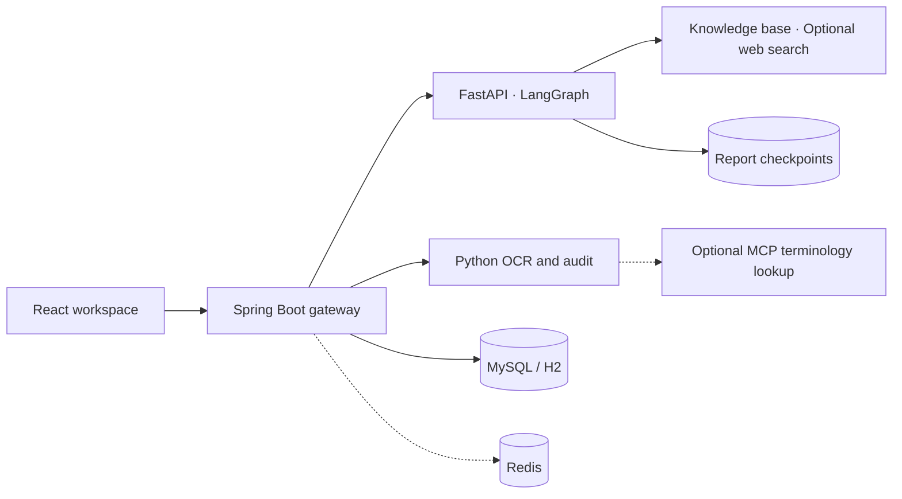

<div align="center">

# Health AI Assistant

**An account-based workspace for everyday health questions, text-based intake, medication information, and lab report review.**

[简体中文](README.md) · [Features](#features) · [Quick start](#quick-start) · [Architecture](#architecture) · [Development and checks](#development-and-checks)

</div>

## Features

| Workspace | What you can do | What you get |
| --- | --- | --- |
| **Health chat** | Ask everyday health questions, organize health notes, and prepare for a visit. Turn on web search for the next question | Streamed answers, knowledge-base excerpts, links to public medical sources, and separate chat history |
| **AI clinic** | Describe symptoms in writing and answer follow-up questions about duration, severity, and other relevant details | A symptom summary and suggested departments. Urgency rules check both the initial message and follow-up answers |
| **Medication assistant** | Ask about a medication, its information leaflet, or interactions. Upload a photo of a package or traceability code | Medication cards, image recognition results, and follow-up answers. Structured medication and interaction checks cover built-in examples |
| **Report review** | Upload a PDF or photo, open a patient-friendly summary, and correct extracted fields against the source page | Results organized by the report's reference ranges, links to source pages, follow-up questions, and visit preparation guidance. Reports and corrections are saved to the account |

Each of the first three workspaces has its own conversation list. Report conversations are saved by report. The workspace includes an option for larger text.

## How the agents work

- **Routing and streaming.** The LangGraph graph uses the current mode and question to select the health advisor, clinic, pharmacy, or report workflow. SSE delivers answers, tool progress, and evidence cards.
- **Follow-up and resume.** Clinic intake asks for missing symptom details. Report review asks one relevant question at a time and lets the user skip or request a conclusion. Report checkpoints are saved so the interview can resume when the report is reopened.
- **Traceable report answers.** Local OCR extracts test names, results, units, and reference ranges. Users can verify uncertain fields on the source page and run the comparison again after correcting them. The answer can link to the report page, and the work record shows model calls, timing, tool results, and fallback reasons.
- **Model configuration by task.** Chat, report interpretation, and medication image recognition can use different models. Supported providers and OpenAI-compatible endpoints are listed in the [configuration example](backend/.env.example).

### Synthetic audit demo

After signing in, open the [audit demo](http://127.0.0.1:5173/#/report-audit-demo) to try batch submissions, background jobs, and report versions using synthetic records. A published correction creates review tasks for previous answers that cite changed fields. The correction view displays those changes and lets the account owner mark a review complete. [Audit workflow and versions](APPLICATION.md)

## Quick start

Install Docker Compose and Node.js. To run AI conversations, set `LLM_PROVIDER`, `LLM_API_KEY`, and any required model parameters using the [configuration example](backend/.env.example). Medication image recognition uses the `VISION_*` settings.

Run the following PowerShell commands from the repository root to generate credentials for a local demo and start the services. When reusing a MySQL volume, keep its original database passwords.

```powershell
$env:AUDIT_AGENT_TOKEN = [guid]::NewGuid().ToString('N')
$env:AUDIT_DB_PASSWORD = [guid]::NewGuid().ToString('N')
$env:AUDIT_MYSQL_ROOT_PASSWORD = [guid]::NewGuid().ToString('N')
docker compose -f compose.audit.yml up --build -d
```

Start the frontend in a separate terminal.

```powershell
cd frontend
npm ci
npm run dev -- --host 127.0.0.1
```

Open the [local workspace](http://127.0.0.1:5173/), create a demo account, and select one of the four workspaces. For a container-free setup with Java 21 and H2, see the [application setup guide](APPLICATION.md).

## Architecture



| Directory | Responsibility |
| --- | --- |
| `frontend/` | Sign-in, consultation, report correction, and SSE rendering with React, TypeScript, Vite, and Tailwind CSS |
| `application/` | Account sessions, ownership checks, report versions, and async audit jobs with Java 21, Spring Boot, and Flyway |
| `backend/agents/` | The FastAPI-backed LangGraph workflow, specialist agents, model configuration, and health knowledge tools |
| `backend/report_audit/` | PDFium, RapidOCR, field checks, evidence Q&A, and the audit workflow |
| `backend/evals/` | Routing, tool-use, and synthetic report evaluations |

## Development and checks

- Run `npm run lint` and `npm run build` in `frontend`.
- Run `mvn test` in `application` for account and audit regressions using test H2 by default.
- Run `uv run python -m evals.report_audit` in `backend` to check field extraction, missed out-of-range results, source-page location, and evidence citations.
- See the [report workspace guide](REPORT_AUDIT.md) for browser tests, synthetic samples, and standalone OCR. For agent debugging, see the [LangGraph runtime](docs/langgraph-runtime.md) and [observability and evaluation](docs/observability-evals.md).
