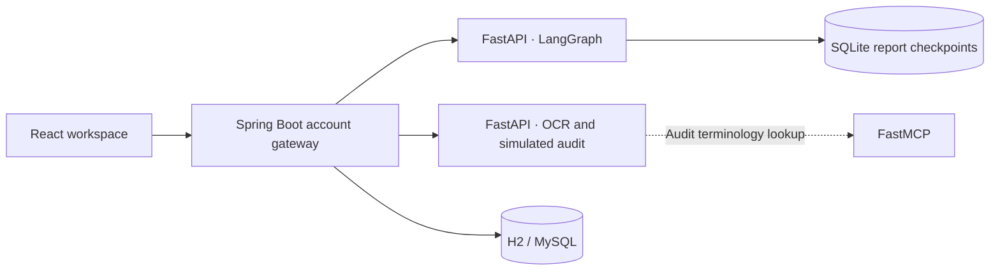
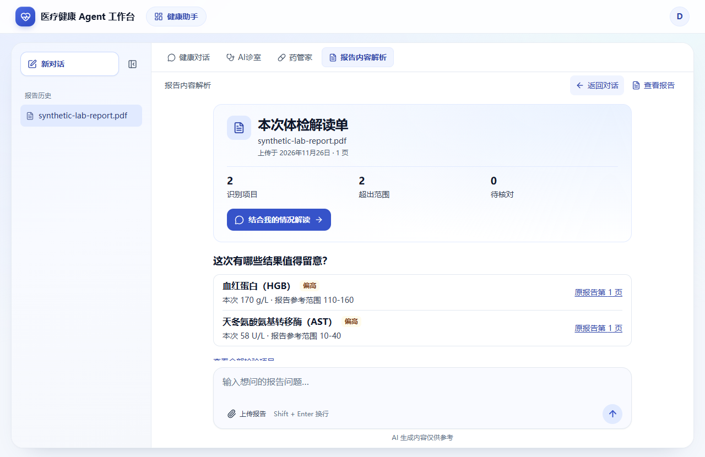

# Medical Health Agent Workbench

**LangGraph multi-agent orchestration and evidence traceability**

An account-based workspace for health questions, text-based intake, medication information, and lab report interpretation. The four entry points share a LangGraph workflow. Upload a PDF or photo to read a patient-friendly explanation, correct fields against the original page, and ask follow-up questions about the same report.

[简体中文](README.md) · [Architecture](#architecture) · [Interface demo](#interface-demo) · [Local setup](#local-setup) · [Evaluation baseline](#evaluation-baseline)

**Local synthetic baseline**　50/52 fields extracted correctly, 13/13 rows located on the source page, and 8/8 correct citations in the simulated audit. [Metric details](#evaluation-baseline)

## Architecture



| Component | Responsibility |
| --- | --- |
| [Frontend](frontend/) | React, TypeScript, Vite, and Tailwind CSS for sign-in, field correction, and SSE rendering |
| [Account gateway](application/) | Java 21, Spring Boot, JDBC, and Flyway for accounts, chat history, and report versions. Local development uses H2, and the container configuration uses MySQL and Redis |
| [Health agents](backend/agents/) | FastAPI, LangGraph, and LangChain route requests by conversation mode and intent. Routes that support a handoff allow at most one per turn. SSE delivers answers, tool progress, and source cards |
| [Report processing](backend/report_audit/) | PDFium reads the PDF text layer and coordinates first. RapidOCR handles scanned pages and photos. Fields are compared with the report's own reference ranges and linked to the source page for correction |

## Interface demo

The demo shows how to upload a synthetic report, correct a field against the original PDF, read the patient-friendly summary, and ask a follow-up question with a citation to the source page.


Follow [Local setup](#local-setup) and sign in. Open [Report interpretation](http://127.0.0.1:5173/#/report-audit) and upload the [synthetic lab report PDF](docs/demo/synthetic-lab-report.pdf). The sample has the unit and reference range in the wrong columns for hemoglobin (HGB). Open the source page, save the correction, then view the updated summary or ask for the hemoglobin result.

<details>
<summary>View interface screenshots</summary>

**Workspace home**


**Source-page review and correction**


**Patient-friendly summary**



**Follow-up with a source-page citation**


</details>

## How the agents work

- **Hybrid retrieval.** Health chat and text-based intake search the knowledge base before generation. Medication tools retrieve knowledge as needed. The shared retriever combines BM25 and vector MMR with RRF. Users can enable a web search for a health chat turn to query Europe PMC and MedlinePlus. [Retrieval design](docs/rag.md)
- **Agentic RAG.** Report interpretation starts with confirmed fields and lab references. The model can call three tools for report lookup, knowledge retrieval, and cross-checking related measurements across at most two tool rounds. The workflow checks citations and out-of-range group coverage, retries invalid answers, and falls back to verified evidence after a timeout or an unsuccessful rewrite. [Report interpretation](backend/report_audit/reading.py)
- **Follow-up and resume.** Text-based intake and report interpretation use `interrupt()` to wait for the user's reply. SQLite checkpoints let report interpretation resume against the matching field revision. Correcting a field reruns the comparison and updates the revision. [LangGraph runtime](docs/langgraph-runtime.md)
- **Simulated audit and MCP.** The [local audit demo](http://127.0.0.1:5173/#/report-audit-demo) uses synthetic source records for background audit jobs, version history, and follow-up reviews after corrections. The terminology node can call FastMCP's `lookup_lab_reference` over Streamable HTTP for 10 lab codes and falls back to a local glossary on failure. [Audit and MCP setup](APPLICATION.md#不使用容器启动账号主版)
- **Observability.** Per-answer work records retain model timings, tool results by round, and fallback reasons. OpenTelemetry and Jaeger tracing are available, with message content and images hidden by default. [Tracing and evaluation](docs/observability-evals.md)

## Local setup

Install Python 3.13, uv, Java 21, Maven, and Node.js. Create `backend/.env` using the [configuration example](backend/.env.example) and set the provider, API key, and model for chat. The `REPORT_READING_*` and `VISION_*` settings let you configure report interpretation and image recognition separately.

Run `uv sync --locked` in `backend` and `npm ci` in `frontend`. Start the services in separate terminals.

| Directory | Command | Local port |
| --- | --- | --- |
| `backend` | `uv run uvicorn report_audit.agent_service:app --host 127.0.0.1 --port 8091` | 8091 |
| `backend` | `uv run uvicorn main:app --host 127.0.0.1 --port 8000` | 8000 |
| `application` | Set the `local` Spring profile and run `mvn spring-boot:run` | 8080 |
| `frontend` | `npm run dev -- --host 127.0.0.1` | 5173 |

Before starting Java, set `AUDIT_AGENT_URL` to `http://127.0.0.1:8091` and `HEALTH_AGENT_URL` to `http://127.0.0.1:8000`. Set the same `AUDIT_AGENT_TOKEN` or `HEALTH_AGENT_TOKEN` in Java and its corresponding Python service. [Full startup commands](APPLICATION.md#不使用容器启动账号主版)

Open the [local workspace](http://127.0.0.1:5173/) and create a local demo account. H2 stores accounts, conversations, and structured reports in `application/data/report-audit.mv.db`. Report checkpoints default to `backend/report-reading-checkpoints.sqlite`. When a user reselects the source file later, the application checks that it matches before rendering its page.

## Evaluation baseline

The fixed synthetic dataset has five scan cases and five simulated audit cases. It covers low contrast, blur, misplaced values, and missing fields. These are results from a local run.

| Metric | Result |
| --- | --- |
| Correctly extracted fields | 50/52 |
| Source-page location | 13/13 |
| Missed out-of-range results | 1/6, sent for manual review |
| Missed simulated source-record discrepancies | 0/4 |
| Correct simulated evidence citations | 8/8 |

Run this command from `backend`. It uses PDFium and RapidOCR on the synthetic scans and verifies discrepancies and cited record revisions in the simulated audit. It runs without model credentials.

```sh
uv run python -m evals.report_audit --json
```

Other checks include `npm run lint` and `npm run build` in `frontend`, plus `mvn test` in `application`. [Fixtures and browser tests](REPORT_AUDIT.md#ocr-与证据基线)
