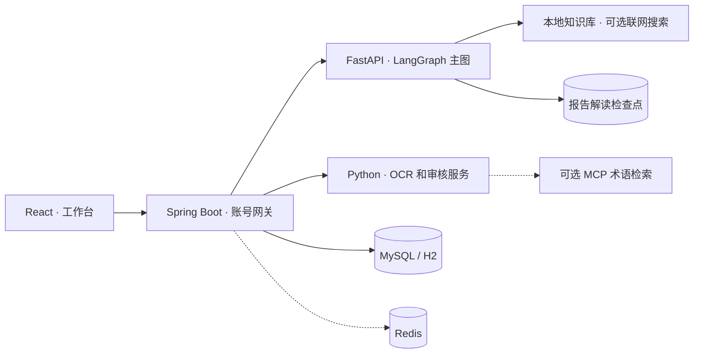

<div align="center">

# 医疗健康 Agent 工作台

**LangGraph 多智能体编排与证据追溯**

把日常健康问答、文字预问诊、药品咨询和体检报告解读放进一个账号工作台。

[English](README.en.md) · [功能全景](#功能全景) · [快速启动](#快速启动) · [技术架构](#技术架构) · [开发与验证](#开发与验证)

</div>

## 功能全景

| 入口 | 可以做什么 | 输出和记录 |
| --- | --- | --- |
| **健康对话** | 了解常见健康问题，整理日常记录和就诊前资料。可以为下一条提问开启「联网搜索」 | SSE 流式回答、知识库摘录、公开医学资料来源及独立对话历史 |
| **AI 诊室** | 通过文字描述症状，按追问补充持续时间、严重程度等信息 | 整理症状要点和建议就诊科室。急症规则会检查首次描述和后续补答 |
| **药管家** | 输入药名了解用途、说明书注意事项和用药相互作用，也可以上传药盒或追溯码照片 | 药品信息卡、图片识别结果和用药问答。药品及相互作用的结构化核对覆盖内置样例 |
| **报告内容解析** | 上传 PDF 或照片，查看体检解读单，打开原页核对并修正字段 | 按报告参考范围排列结果，附原页依据、指标追问和就诊准备说明。报告与校正记录随账号保存 |

登录后，前面三个咨询入口各有独立的会话列表。报告入口按每份报告保留解读和追问。工作台支持长辈模式，放大界面文字。

## 智能体如何工作

- **按任务选择流程。** LangGraph 主图根据当前模式和问题，进入健康顾问、文字预问诊、用药咨询或报告解读流程。回答、工具状态和资料卡片通过 SSE 推送到页面。
- **等患者补答再继续。** 预问诊聚焦尚未收集的症状信息。报告解读根据当前结果与已知情况一次补问一项，用户可以跳过或先看结论。报告解读的检查点随该份报告保存，重开报告后可继续补答。
- **保留报告依据。** 本地 OCR 提取检验项目、结果、单位和参考范围。可疑字段标为待核对，校正后重新比对。回答能引用原报告页码，工作记录展示模型调用次数、耗时、工具执行结果和回退原因。
- **分开配置模型用途。** 对话、报告解读和药品图片识别可使用不同模型配置。可用供应商与 OpenAI 兼容端点见[模型配置示例](backend/.env.example)。

### 模拟报告审核

登录后可打开[模拟核对演示](http://127.0.0.1:5173/#/report-audit-demo)，用合成病历体验批量提交、后台任务和版本回看。发布字段更正后，系统根据原答复引用的字段创建复核任务，在「更正影响」里可查看新旧字段并标记已复核。[审核流程与版本说明](APPLICATION.md)

## 快速启动

需要 Docker Compose 和 Node.js。使用 AI 对话前，按[模型配置示例](backend/.env.example)设置 `LLM_PROVIDER`、`LLM_API_KEY` 及所需的模型参数。药盒和追溯码图片识别使用 `VISION_*` 配置。

在仓库根目录运行以下 PowerShell 命令，生成本机体验用的服务凭据和数据库密码，然后启动服务。重用已有 MySQL 卷时，请使用原来初始化的数据库密码。

```powershell
$env:AUDIT_AGENT_TOKEN = [guid]::NewGuid().ToString('N')
$env:AUDIT_DB_PASSWORD = [guid]::NewGuid().ToString('N')
$env:AUDIT_MYSQL_ROOT_PASSWORD = [guid]::NewGuid().ToString('N')
docker compose -f compose.audit.yml up --build -d
```

另开终端启动前端。

```powershell
cd frontend
npm ci
npm run dev -- --host 127.0.0.1
```

打开[本机工作台](http://127.0.0.1:5173/)，创建体验账号。在顶部切换四个功能。也可以通过 Java 21 和本地 H2 运行账号版。[完整启动说明](APPLICATION.md)

## 技术架构



| 目录 | 主要职责 |
| --- | --- |
| `frontend/` | React、TypeScript、Vite 和 Tailwind CSS。登录、健康咨询、报告校正和 SSE 渲染 |
| `application/` | Java 21、Spring Boot 和 Flyway。会话、所有权校验、报告版本和异步审核任务 |
| `backend/agents/` | FastAPI 接入的 LangGraph 主图、专业智能体、模型适配和健康知识工具 |
| `backend/report_audit/` | PDFium、RapidOCR、字段核对、证据问答和复核流程 |
| `backend/evals/` | 路由、工具调用及合成报告评测 |

## 开发与验证

- 前端在 `frontend` 运行 `npm run lint` 和 `npm run build`。
- 账号及审核回归在 `application` 运行 `mvn test`，默认使用测试专用 H2。
- 合成报告评测在 `backend` 运行 `uv run python -m evals.report_audit`，检查字段提取、异常漏检、原页定位及证据引用。
- 浏览器回归、合成样本生成和单机 OCR 调试见[报告工作台说明](REPORT_AUDIT.md)。智能体调试见[LangGraph 运行时](docs/langgraph-runtime.md)和[可观测与评估](docs/observability-evals.md)。
