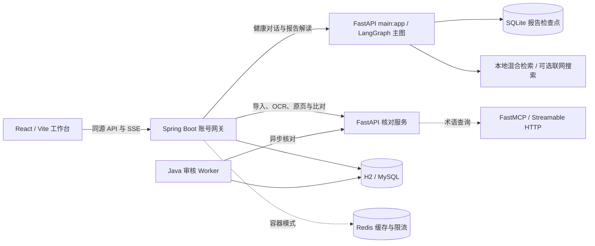

# 医疗健康 Agent 工作台

[English](README.en.md) · [演示](#演示) · [功能](#功能) · [架构](#架构) · [快速开始](#快速开始) · [评测与测试](#评测与测试)

在同一个账号工作台里做健康问答、文字预问诊、用药咨询和检验报告解读。报告解析把识别结果关联到原件的页码和行位置。你可以复核并更正字段、查看患者版解读单，再用同一份报告继续追问。另有一套使用合成病历的异步审核演示，覆盖原始记录比对、报告版本和对既有答复的更正影响。

## 演示


1. 按[快速开始](#快速开始)启动并登录，打开[报告内容解析（需本地启动）](http://127.0.0.1:5173/#/report-audit)，上传[合成检验报告 PDF](docs/demo/synthetic-lab-report.pdf)。
2. 在「查看报告」里打开需要核对的血红蛋白（HGB）行，对照原页更正错列的单位和参考范围。
3. 查看更新后的患者版解读单，或问「这份报告上的血红蛋白是多少？」并从回答打开原页引用。
4. 在[模拟核对入口（需本地启动）](http://127.0.0.1:5173/#/report-audit-demo)载入内置样例，询问血红蛋白和白细胞的原始记录。采用血红蛋白的原始记录提交更正后，新版本复核 1 项、沿用 2 项。打开「更正影响」可复查受影响的答复。

<details>
<summary>查看截图</summary>

| 工作台与报告解读 | 原页校正与证据追问 |
| --- | --- |
|  |  |
|  |  |

</details>

## 功能

| 入口 | 可以做什么 |
| --- | --- |
| 健康对话 | 询问健康知识、生活方式、风险及就诊准备，查看本地检索和联网来源卡片。联网开关也可用于非预问诊的用药对话。 |
| AI 诊室 | 文字预问诊，先检查危险信号，再提取并补问症状信息。提供紧急提醒、就医时效、科室建议及分诊卡。 |
| 药管家 | 通过药名、药盒照片或追溯码图片咨询药品说明、禁忌和注意事项。工具覆盖相互作用、非处方药信息、剂量计算和模拟药店展示。追溯码走图片识别。 |
| 报告内容解析 | 上传 PDF 或 JPG、PNG、WebP 照片，浏览整份报告和单项解读，筛选超范围、待确认和全部结果，查看原页高亮、人工校正和患者版解读单。可带着报告继续问单项、关联指标和整份报告。 |

工作台支持注册、登录、退出，以及健康对话、AI 诊室、药管家的多会话新建、切换和清除记录。已保存的报告可从报告历史重开。桌面侧栏和移动端历史面板共用同一套会话布局，长辈模式放大文字。

报告模块还提供两个演示流程。

- **模拟检验审核**支持粘贴和导入模板 PDF、Excel（`.xlsx` / `.xls`）及 UTF-8 文本，保存草稿，单份或批量提交（每批最多 25 份），查询进度、重试和回看历史版本。可查询当前和历史就诊的原始记录、校正后增量复核，并人工确认受影响的答复。[打开模拟审核（需本地启动）](http://127.0.0.1:5173/#/report-audit-demo)
- **照片对话**提供视觉模型识别、按住查看的模糊预览、粘贴检验明细、会话内追问和清空历史。单机模式入口为 `#/report-photo`。[打开照片解读演示（需本地启动）](http://127.0.0.1:5173/#/report-photo-demo)

## 架构



| 层 | 技术与职责 |
| --- | --- |
| [前端](frontend/) | React 19、TypeScript、Vite 7、Tailwind CSS、PostCSS、Lucide。React Context 管理界面状态，React Markdown / remark-gfm 渲染回复，类型化 SSE 驱动文本、进度和结果卡。ESLint、TypeScript 和 Playwright 用于开发验证。 |
| [应用层](application/) | Java 21、Spring Boot 3.5、Spring MVC、JDBC / HikariCP、Flyway、Actuator、Resilience4j。账号、会话、结构化报告、版本、任务与审核问答存于 H2 或 MySQL；Redis 对已完成结果提供版本化缓存，并通过 Lua 实现限流。 |
| [Agent 服务](backend/agents/) | Python 3.13、uv、FastAPI / Uvicorn、Pydantic、LangGraph、LangChain、httpx、OpenAI SDK 与兼容 API。管理路由、上下文、工具、检查点和服务端推送（SSE）。 |
| [报告处理](backend/report_audit/) | PDFium（`pypdfium2`）、pypdf、RapidOCR / ONNX Runtime、Pillow、openpyxl、xlrd。SQLite 保存单机核对快照。 |
| [FastMCP 术语服务（独立进程）](backend/report_audit/mcp_server.py) | Compose 中的 `knowledge` 服务通过 Streamable HTTP 提供检验术语查询。 |
| [运行与验证](docs/observability-evals.md) | Docker / Compose、OpenTelemetry / OpenInference、OTLP/HTTP、Jaeger、可选 LangSmith，以及 Python unittest、JUnit / Spring Boot Test、本地评测和可选 DeepEval。 |

### Agent 路由、工具与检索

- **统一主图。** `StateGraph` 按结构化报告请求、显式模式、活跃角色和意图分派。健康顾问、用药和照片／文本报告对话的模型生成路径使用 ReAct 工具循环。文字预问诊由独立子图处理，先做规则安全筛查，再用一次结构化调用提取症状并拟定追问。信息不足时用 `interrupt()` 等待回复，进入分诊结论节点后使用 ReAct。结构化报告由证据检查和解读节点处理。支持转交的分支每轮最多用 `Command` 转交一次。[运行时说明](docs/langgraph-runtime.md)
- **技能注册。** `SKILL.md` 的 YAML 元数据用于发现技能并按角色标签加载。Pydantic 输入输出封装为 LangChain 工具，`load_skill` 支持按名称调度。内置 `emergency_triage`（危险信号）、`symptom_scorer`（症状评分）、`health_calculator`（BMI 等）、`risk_assessor`（Framingham / FINDRISC）、`lab_interpreter`（检验范围比对）和 `medication_calculator`（用药计算）。[技能系统](docs/skills.md)
- **本地混合检索。** 健康顾问和预问诊在回答前检索，药品工具按需检索，照片／文本报告分支可查检验资料。知识库将 Markdown 按标题和中文标点切片，保留来源及章节元数据。BM25 和向量最大边际相关性（MMR）通过 RRF 按 0.3 / 0.7 融合，支持多查询并行、去重和按来源过滤。嵌入支持 Hugging Face / BGE、OpenAI 和 Ark，向量存储支持 Chroma、FAISS、Qdrant、pgvector 和内存索引。[检索与索引](docs/rag.md)
- **可选联网检索。** 用户主动打开联网搜索后，服务将脱敏问题改写成受限医学关键词，优先采用 Europe PMC 的 PubMed 记录，结果缺失时可使用 MedlinePlus 健康主题。搜索与本地检索状态通过独立资料卡展示。[联网检索实现](backend/agents/web_search.py)
- **模型适配。** 文本、结构化报告解读及图片识别可分别配置。文字模型负责路由、结构化提取和工具调用，视觉模型处理药盒、追溯码和独立照片对话。原页核对走本机 PDF / OCR 流程。[模型配置示例](backend/.env.example)

### 从报告原件到可追溯解读

1. **提取与校对。** PDF 上限 1 MB、5 页，照片上限 8 MB、2400 万像素。系统优先读取 PDF 文字层和坐标，扫描页及照片由 RapidOCR 在本机识别。疑难单元格可裁剪复读。系统按报告自带参考范围标记高、低、范围内或待确认，并保留原识别值、页码及位置。用户可更正项目、结果、单位和参考范围。已保存报告通过 SHA-256 校验重选的原件，按需重绘原页。无识别结果时可重新识别。
2. **核验证据。** 主图复用当前报告的已确认字段，校验关联项是否缺失、待确认或有多条采样记录。检验知识按别名筛选后做 BM25 排序，已有本地 BGE 权重时初始模型解读可增加向量检索与 RRF。血常规支持血小板压积及白细胞总数、分类比例和绝对计数的联算核验，记录同次采样条件、单位和显示精度。
3. **补问与恢复。** 根据异常项和问题向用户逐次补问，最多三次，可直接回答、跳过、先看结论或开启新问题。报告任务通过 `interrupt()` 和 `Command(resume=...)` 恢复，SQLite 检查点按报告字段修订关联。字段更正后重新比对，并按新修订重新解读最近的问题。
4. **Agentic RAG 与回退。** 模型可用 `lookup_report`、`search_lab_knowledge`、`check_lab_relationships` 补证，最多两轮工具调用。程序校验引用白名单和必答异常组，必要时定向重写。待确认项、紧急情形及模型失败可走规则和已核验证据。校验后的内容可通过 SSE 渐进显示，答复附原页引用、资料来源、缺失信息及工作记录。[报告流程](REPORT_AUDIT.md) · [解读实现](backend/report_audit/reading.py)

### 异步审核与更正影响

- **规则核对。** 模板导入校验模拟患者、就诊、指标和采样日期，支持 10 种检验代码及已登记的别名。LangGraph 从可替换的 `EvidenceSource` 查询原始记录，用十进制精确比较和明确登记的单位换算检查数值、单位、日期及缺失证据。多条记录无法唯一匹配时转人工。原始记录编号与修订随引用返回。[规则实现](backend/report_audit/workflow.py)
- **任务与版本。** 应用层在事务中写入 `Idempotency-Key`、报告与任务，按预期版本接收更正。MySQL Worker 用 `FOR UPDATE SKIP LOCKED` 领取任务，使用 45 秒租约及领取令牌保护提交，支持回收、退避重试和不可变版本快照。报告项、原始记录和规则版本相同才复用该项核对结果。规则版本变更支持全量重核。
- **证据问答。** 规则路由将问题交给原始／历史记录或知识检索节点，支持接续上一次提到的检验项目。`REPORT_AUDIT_LLM_ROUTER=1` 可在规则无法确定意图时启用结构化分类。FastMCP 的 `lookup_lab_reference` 通过 Streamable HTTP 提供术语服务，可启用混合检索，失败时回退本地词表。
- **更正影响。** 问答图记录答复引用的报告字段。Java 发布新版本时按字段比对快照，在同一事务中为受影响的旧答复生成复核任务。旧版本问答与更正并发完成时，也会检查后续版本。可重问并人工确认，未受影响的答复仍可查看。[事务与任务设计](APPLICATION.md)

### 会话、流式响应与数据

- Java 以 PBKDF2 保存口令哈希，使用 HttpOnly、SameSite=Strict 会话 Cookie 和账号归属校验。聊天先保存用户提问，通过 SSE 转发 `node_start`、`node_end`、`tool_start`、`tool_end`、`text`、`card` 等事件，在回复成功写入后才确认完成。请求去重、数据库租约、虚拟线程、并发上限和熔断器限制断流及并发影响。
- 每条账号文字会话可加载最近 50 轮。应用网关在 Agent 状态丢失后会重放最近 4 轮完整问答，并在清除历史时请求删除对应 Agent 状态。普通聊天检查点默认在内存，支持切换 SQLite。单机模式的文字历史保存在浏览器。独立照片对话使用会话范围的线程标识。
- H2 本机数据位于 `application/data/report-audit.mv.db`，账号报告检查点默认位于 `backend/report-reading-checkpoints.sqlite`。账号保存结构化字段、校正、问答及字段修订。原附件和原页图像按需处理。配置远程模型时，相关对话内容或用于识别的图片会发送给所选服务。开发和评测使用合成或脱敏样本。产品用于健康信息和就医准备，诊断与用药决策应由专业人员完成。[应用层数据范围](APPLICATION.md#接口与数据范围)

## 快速开始

需要 Python 3.13、uv、Java 21、Maven，以及 Node.js 20.19+（20.x）或 22.12+ 和 npm。下面的 PowerShell 命令从仓库根目录开始，每个服务使用独立终端。工作台的界面语言为简体中文。

先安装后端依赖，从样例创建 `backend/.env`，已有配置可继续使用。

```powershell
cd backend
uv sync --locked
if (-not (Test-Path .env)) { Copy-Item .env.example .env }
```

在 `.env` 中选择 `LLM_PROVIDER` 并填入对应 API Key 和模型名。为两个 Python 服务分别设置随机的 `AUDIT_AGENT_TOKEN` 和 `HEALTH_AGENT_TOKEN`，Java 终端使用对应的相同值。合成原始记录审核和 OCR 可在无模型凭据的情况下运行。若只试这两项，移除 `.env` 中的占位模型凭据。

**终端 1 · 核对和 OCR 服务（8091）**

```powershell
cd backend
uv run uvicorn report_audit.agent_service:app --host 127.0.0.1 --port 8091
```

**终端 2 · 健康 Agent 和报告解读（8000）**

```powershell
cd backend
$env:RAG_WARMUP = '0'
uv run uvicorn main:app --host 127.0.0.1 --port 8000
```

**终端 3 · H2 账号网关和同进程 Worker（8080）**

```powershell
cd application
$env:SPRING_PROFILES_ACTIVE = 'local'
$env:AUDIT_AGENT_URL = 'http://127.0.0.1:8091'
$env:HEALTH_AGENT_URL = 'http://127.0.0.1:8000'
$env:AUDIT_AGENT_TOKEN = '<与 backend/.env 中 AUDIT_AGENT_TOKEN 相同>'
$env:HEALTH_AGENT_TOKEN = '<与 backend/.env 中 HEALTH_AGENT_TOKEN 相同>'
mvn spring-boot:run
```

**终端 4 · Web 工作台（5173）**

```powershell
cd frontend
npm ci
npm run dev -- --host 127.0.0.1
```

打开[本机工作台](http://127.0.0.1:5173/)并注册本地账号。需要共享知识库检索时，在 `backend` 运行 `uv run python -m rag.ingest`，改动 `rag/documents/` 后加 `--rebuild`。默认 Hugging Face 嵌入首次使用可能下载模型，`RAG_WARMUP=0` 将初始化延迟到首次检索。需要本机 MCP 时，启动 `uv run uvicorn report_audit.mcp_server:app --host 127.0.0.1 --port 8092`，并为核对服务设置 `AUDIT_MCP_URL=http://127.0.0.1:8092/mcp` 后重启。[应用启动与离线配置](APPLICATION.md)

### 其他运行方式

| 方式 | 配置 |
| --- | --- |
| 单机调试 | 启动 `main:app`，前端启动前设置 `VITE_AUDIT_ASYNC=0` 和 `VITE_MANAGED_HEALTH_CHAT=0`。`#/report-audit` 进入同步模拟审核，`#/report-photo` 进入照片对话。同步审核使用 `REPORT_AUDIT_DB` 指定的 SQLite，默认 `backend/report_audit.sqlite3`。[单机调试](REPORT_AUDIT.md#单机调试) |
| 离线 | 合成审核和 OCR 使用本地规则与随依赖安装的 OCR 权重。文字或视觉模型可接提前准备好的本地 OpenAI-compatible 服务，例如 Ollama，混合检索也需要提前准备嵌入模型。[离线使用](APPLICATION.md#无外网时使用) |
| Docker Compose | `compose.audit.yml` 定义 MySQL 8.4、Redis 7.4、Java 网关与 Worker、两个 Python 服务和 MCP，前端另启。按应用层说明配置服务凭据与数据库密码，从仓库根目录启动。[容器配置](compose.audit.yml) · [启动命令](APPLICATION.md#用-docker-compose-启动服务) |

### 常用配置与接口

| 配置 | 用途 |
| --- | --- |
| `LLM_PROVIDER`、`LLM_API_KEY`、`LLM_MODEL`、`LLM_BASE_URL` | OpenAI-compatible 对话模型。支持 `ark`（默认）、`openai`、`deepseek`、`qwen`、`zhipu`、`custom`，也可用供应商专用变量。 |
| `REPORT_READING_*`、`VISION_*` | 分别覆盖报告解读、视觉识别的 `PROVIDER`、`API_KEY`、`MODEL` 和 `BASE_URL`。 |
| `EMBEDDING_PROVIDER`、`EMBEDDING_MODEL`、`VECTOR_STORE` | 默认 `huggingface` / `BAAI/bge-small-zh-v1.5` / `chroma`。 |
| `CHECKPOINTER`、`CHECKPOINT_DB_PATH`、`AUDIT_READING_CHECKPOINT_DB` | 普通对话 `memory` 或 `sqlite`，以及独立的报告解读 SQLite 路径。 |
| `REPORT_AUDIT_KNOWLEDGE`、`REPORT_AUDIT_LLM_ROUTER`、`AUDIT_MCP_URL` | 模拟审核的可选向量混合检索、模型意图分类及术语服务地址。使用 MCP 时，在术语服务进程开启混合检索。 |
| `HEALTH_GATEWAY_PROXY`、`HEALTH_PYTHON_PROXY`、`VITE_HEALTH_API_URL`、`VITE_AUDIT_API_URL` | Vite 开发／预览网关代理和单机 Python 服务地址。生产反代将 `/api/health` 转发给 Java，并关闭 SSE 缓冲；HTTPS 下启用 `HEALTH_SECURE_COOKIE=true`。 |
| `OBSERVABILITY_PROVIDER`、`TRACE_CONTENT`、`TRACE_IMAGES`、`EVAL_PROVIDER` | `none` / `otel` / `langsmith`，内容与图片追踪默认关闭；评测支持 `local` / `deepeval`。 |

- **账号 API** 经 `/api/health` 提供账号、会话与 SSE、`/report-reading` 报告导入校正和问答、`/report-audit` 审核与复核、`/report-photo` 独立照片会话。审核请求支持 `Idempotency-Key`，更正携带预期版本。[Java 控制器](application/src/main/java/dev/reportaudit/)
- **FastAPI** 提供[健康探针](http://127.0.0.1:8000/health)和 [Swagger](http://127.0.0.1:8000/docs)。独立调试可访问 `/api/chat`、`/api/vision-chat` 与 `/api/report-audit`；网关调用使用令牌保护的 `/internal/health` 和 `/internal/report-audit`。Java Actuator 暴露 `/actuator/health` 和 `/actuator/metrics`。[健康服务入口](backend/main.py) · [核对服务入口](backend/report_audit/agent_service.py)

## 评测与测试

固定合成基线包含 5 个扫描用例和 5 个模拟核对用例，覆盖低对比、模糊、错列及字段缺失。现有基线记录如下。统计口径和样本导出方法见[评测说明](REPORT_AUDIT.md#ocr-与证据基线)。

| 指标 | 合成基线 |
| --- | --- |
| 正确提取的项目、结果、单位和参考范围字段 | 50/52 |
| 页码匹配且返回有效坐标的行 | 13/13 |
| 超范围自动漏检 | 1/6 |
| 模拟原始记录差异漏检 | 0/4 |
| 模拟原始记录答复的证据引用正确 | 8/8，核对记录 ID、版本和顺序 |

*超范围自动漏检按检验结果行统计。扫描集中有 6 行标注为超出参考范围，其中 1 行进入待核对。*

在新终端运行回归命令。若沿用启动服务的终端，运行 Python 单测前将 `RAG_WARMUP` 恢复为默认的 `1`，以覆盖知识库预热测试。

```sh
# backend · 实际 PDFium / RapidOCR 管线及模拟证据问答，无模型凭据
uv run python -m evals.report_audit --json
uv run python -m evals.report_audit --export-pdfs ../.tmp_test/synthetic-reports

# backend · API、配置、图、工具、追踪和报告回归
uv run python -m unittest test_llm.py test_vision.py test_main_config.py test_observability.py test_evals.py test_skill_tools.py test_exit_phrases.py test_graph_build.py test_handoff.py test_clinic_graph.py test_cards.py test_web_search.py test_report_audit.py test_report_reading.py test_report_reading_task.py test_report_reasoning.py test_shared_report_graph.py

# backend · 使用已配置模型评估路由和工具选择
uv run python -m evals
uv run --extra eval python -m evals --provider deepeval
```

- `application` 中运行 `mvn test`，默认用 H2 覆盖账号、网关 SSE 和审核存储。也可用独立 MySQL 测试库。[应用层测试](APPLICATION.md#不使用容器启动账号主版)
- `frontend` 中运行 `npm run lint` 和 `npm run build`。服务启动后执行 `npx playwright install chromium`，运行 `node test_report_reading.cjs`（账号报告）、`node test_report_audit.cjs`（审核与更正）、`node test_scan_review.cjs`（移动端原页与校正弹窗）。页面核对测试将 `AUDIT_SCAN_TEST_PDF` 指向导出的 `misplaced-unit-and-reference.pdf`，账号报告测试还需用 `AUDIT_READING_TEST_PHOTO` 指向对应的合成照片。[浏览器验收](REPORT_AUDIT.md)
- 用 `docker compose -f compose.observability.yml up -d` 启动本地 Jaeger。`OBSERVABILITY_PROVIDER=otel` 通过 OpenInference 将模型与工具调用等运行指标送往 OTLP/HTTP，默认端点为本机 `4318/v1/traces`，界面端口 `16686`。也可接入 LangSmith。报告回答的工作记录显示模型耗时、工具结果、缺失证据与回退原因。[追踪配置](docs/observability-evals.md)

## 文档与贡献

| 路径 | 内容 |
| --- | --- |
| [APPLICATION.md](APPLICATION.md) · [REPORT_AUDIT.md](REPORT_AUDIT.md) | 应用网关、数据持久化、任务、报告流程和样例。 |
| [docs/langgraph-runtime.md](docs/langgraph-runtime.md) · [backend/docs/](backend/docs/) | 主图、状态、转交、预问诊和 SSE 设计。 |
| [docs/rag.md](docs/rag.md) · [docs/skills.md](docs/skills.md) · [docs/observability-evals.md](docs/observability-evals.md) | 知识库、工具扩展、追踪和评测。 |
| [frontend/README.md](frontend/README.md) · [前端设计系统](frontend/docs/design-system.md) · [AGENTS.md](AGENTS.md) | 前端开发、界面规范和仓库贡献约定。 |

提交前按改动范围运行回归。新增技能遵循 `SKILL.md`、`skill.py` 和 `__init__.py` 的目录约定；变更 SSE 时同步 [TypeScript 类型](frontend/src/types/index.ts)及事件解析。避免提交 `.env`、报告原件、模型凭据、检查点和生成索引。
