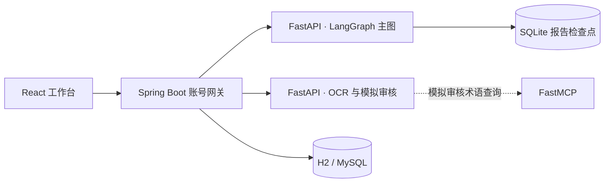
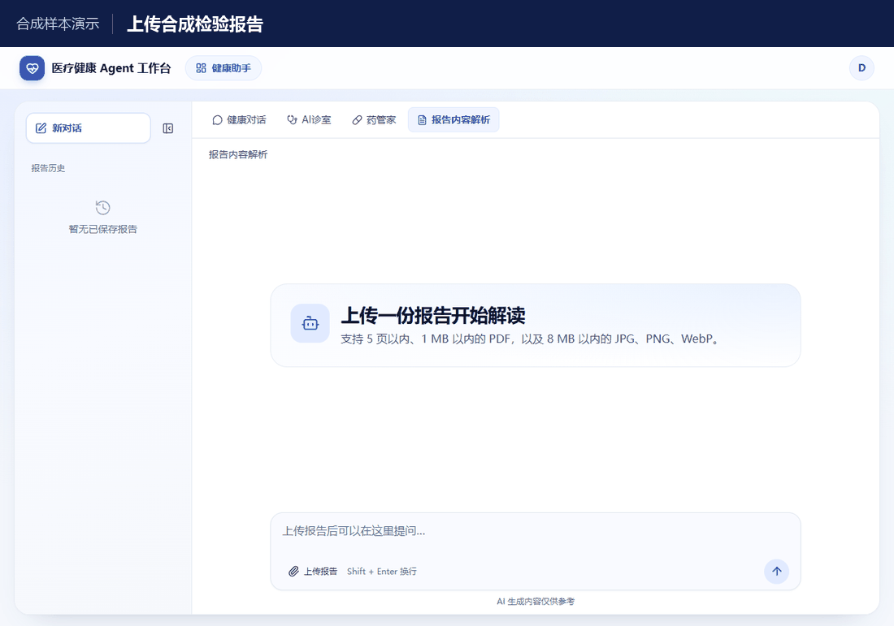
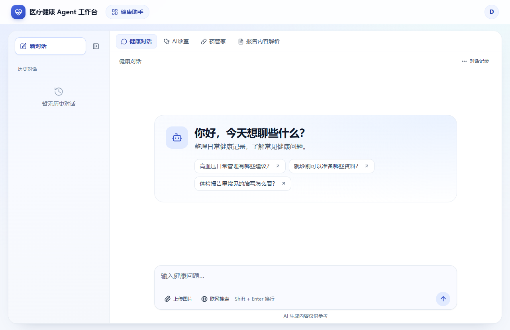
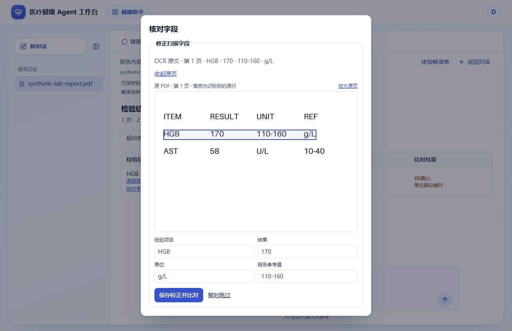
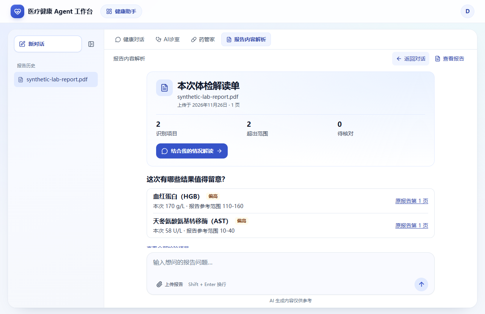
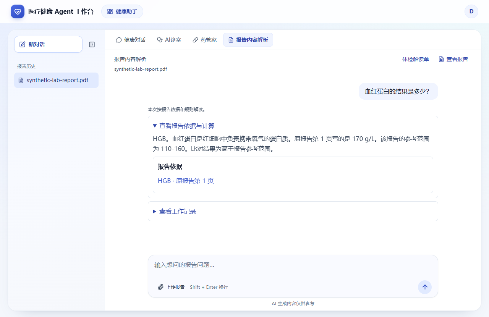

# 医疗健康 Agent 工作台

**LangGraph 多智能体编排与证据追溯**

一个账号下使用健康问答、文字预问诊、用药咨询和体检报告解读。四个入口共用 LangGraph 主图。上传 PDF 或照片后，可以查看患者版解读、对照原页校正字段，并基于同一份报告继续追问。

[English](README.en.md) · [架构](#技术架构) · [界面演示](#界面演示) · [本地启动](#本地启动) · [评测基线](#评测基线)

**本地合成样本基线**　字段提取 50/52，原页定位 13/13，模拟审核引用 8/8。[查看评测口径](#评测基线)

## 技术架构



| 组件 | 职责 |
| --- | --- |
| [前端](frontend/) | React、TypeScript、Vite 和 Tailwind CSS。处理登录、报告校正和 SSE 渲染 |
| [账号网关](application/) | Java 21、Spring Boot、JDBC、Flyway。管理账号、会话与报告版本，本地使用 H2，容器配置使用 MySQL 和 Redis |
| [健康 Agent](backend/agents/) | FastAPI、LangGraph 和 LangChain。按会话模式和意图路由，支持跨角色转交的分支每轮最多转交一次。通过 SSE 推送回答、工具状态和资料卡片 |
| [报告处理](backend/report_audit/) | PDFium 优先提取 PDF 文本与坐标，扫描页及照片使用 RapidOCR。按原报告参考范围标记结果，保留页码和位置供用户校正 |

## 界面演示

动图演示了上传合成报告、对照原 PDF 校正字段、查看患者版解读单，以及追问指标并打开原页引用。



按[本地启动](#本地启动)运行工作台并登录后，打开[报告内容解析](http://127.0.0.1:5173/#/report-audit)，上传[合成检验报告 PDF](docs/demo/synthetic-lab-report.pdf)。样例里的血红蛋白（HGB）单位与参考范围错列，可点开原页核对并保存校正，再查看更新后的解读或追问血红蛋白结果。

<details>
<summary>查看界面截图</summary>

**工作台首页**



**对照原页校正字段**



**患者版解读单**



**指标追问与原页引用**



</details>

## Agent 工作流程

- **混合检索。** 健康问答和预问诊在生成前查本地知识库，药管家在用药工具内按需检索。共享检索器采用 BM25 与向量 MMR 召回，并用 RRF 融合。用户也可以为一轮健康对话开启联网搜索，查询 Europe PMC 和 MedlinePlus。[检索说明](docs/rag.md)
- **Agentic RAG。** 报告解读先加载确认字段和检验知识，再由模型决定是否调用报告查询、检验知识检索、指标联算三个工具，最多补证两轮。回答校验引用白名单和异常项覆盖，校验失败时定向重写，超时或重写失败时依据已核实证据回退。[报告解读实现](backend/report_audit/reading.py)
- **人工补答与恢复。** 预问诊和报告解读可用 `interrupt()` 等待用户补充情况。报告解读用 SQLite 保存检查点，重开报告时按报告字段版本恢复任务。用户校正字段后会重新比较并更新版本。[LangGraph 运行时](docs/langgraph-runtime.md)
- **模拟审核与 MCP。** 本地[模拟核对演示](http://127.0.0.1:5173/#/report-audit-demo)使用合成原始记录，支持异步审核、版本回看和更正影响复核。其术语节点可通过 Streamable HTTP 调用 FastMCP 的 `lookup_lab_reference`，覆盖 10 种检验代码，调用失败时回退本地词表。[审核与 MCP 配置](APPLICATION.md#不使用容器启动账号主版)
- **可观测性。** 报告工作记录保存模型耗时、每轮工具结果和回退原因。链路追踪可接入 OpenTelemetry／Jaeger，默认隐藏正文及图片。[追踪与评估](docs/observability-evals.md)

## 本地启动

需要 Python 3.13、uv、Java 21、Maven 和 Node.js。在 `backend` 中按[配置示例](backend/.env.example)创建 `.env`，设置对话模型的供应商、API Key 和模型名。可分别配置 `REPORT_READING_*` 与 `VISION_*`，用于报告解读和图片识别。

先在 `backend` 执行 `uv sync --locked`，在 `frontend` 执行 `npm ci`。然后分别打开终端，按下表启动服务。

| 目录 | 命令 | 本机端口 |
| --- | --- | --- |
| `backend` | `uv run uvicorn report_audit.agent_service:app --host 127.0.0.1 --port 8091` | 8091 |
| `backend` | `uv run uvicorn main:app --host 127.0.0.1 --port 8000` | 8000 |
| `application` | 配置 `local` profile 后运行 `mvn spring-boot:run` | 8080 |
| `frontend` | `npm run dev -- --host 127.0.0.1` | 5173 |

启动 Java 前，将 `AUDIT_AGENT_URL` 指向 `http://127.0.0.1:8091`，`HEALTH_AGENT_URL` 指向 `http://127.0.0.1:8000`。Java 与相应 Python 服务使用同一份服务凭据 `AUDIT_AGENT_TOKEN` 或 `HEALTH_AGENT_TOKEN`。[完整启动命令](APPLICATION.md#不使用容器启动账号主版)

打开[本机工作台](http://127.0.0.1:5173/)，注册本地体验账号。H2 将账号、对话及结构化报告保存在 `application/data/report-audit.mv.db`。报告检查点默认写入 `backend/report-reading-checkpoints.sqlite`。恢复原页预览时，应用会校验用户重新选择的原件。

## 评测基线

评测集包含 5 个扫描用例和 5 个模拟核对用例，覆盖低对比度、模糊、错列和字段缺失。以下是固定合成集的一次本地评测结果。

| 指标 | 结果 |
| --- | --- |
| 字段提取准确率 | 50/52 |
| 原页定位 | 13/13 |
| 范围异常漏检 | 1/6，转待核对 |
| 模拟原始记录差异漏检 | 0/4 |
| 模拟证据引用正确率 | 8/8 |

在 `backend` 执行下列命令。它使用实际 PDFium 和 RapidOCR 跑扫描样本，并对模拟记录差异及引用的记录版本进行校验，无需模型凭据。

```sh
uv run python -m evals.report_audit --json
```

更多验证包括前端 `npm run lint`、`npm run build`，以及在 `application` 运行 `mvn test`。[样本与浏览器回归](REPORT_AUDIT.md#ocr-与证据基线)
